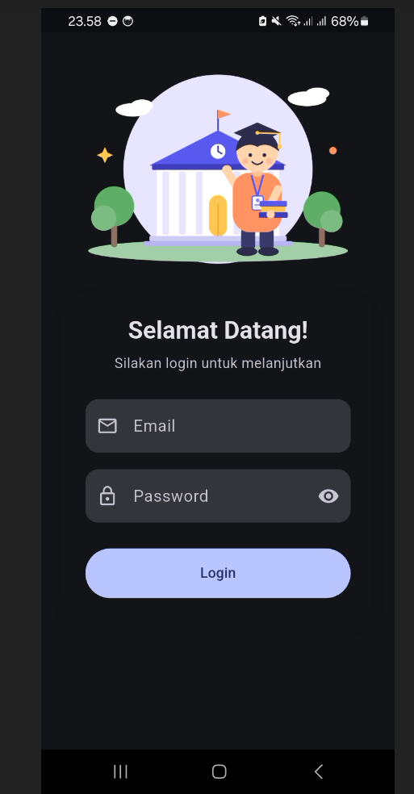

# 📱 UTS Aplikasi Mobile

Aplikasi Mobile berbasis Flutter sebagai tugas Ujian Tengah Semester mata kuliah Pemrograman Mobile Lanjutan.

## 👤 Identitas Mahasiswa

| Keterangan | Detail          |
| ---------- | --------------- |
| Nama       | Rafly Kurniawan |
| NIM        | 1124160165      |
| Kelas      | [Isi Kelas Lu]  |

## 🔗 Project Links

- 📦 **APK Release:** [Download Aplikasi](MASUKKAN_LINK_RELEASE)
- 🎥 **Video Demo:** [Tonton di YouTube](MASUKKAN_LINK_YOUTUBE)

## ✨ Fitur Aplikasi

- **Login Page** – Halaman login dengan validasi email dan password.
- **Profile Page** – Menampilkan informasi dan data profil mahasiswa.
- **About Page** – Menampilkan informasi tentang diri, pendidikan, dan keahlian.
- **Edit Profile** – Memungkinkan pengguna mengubah informasi profil.
- **Light & Dark Mode** – Mendukung dua pilihan tema tampilan aplikasi.

## 📸 Application Screenshots

### 1. Login Page

\
   \ \

### 2. Profile Page

\
   \ \

### 3. About Page

\
   \ \

---

\

&#x20; \*\*Developed by Rafly Kurniawan\*\*

Flutter & Dart | 2026

\

