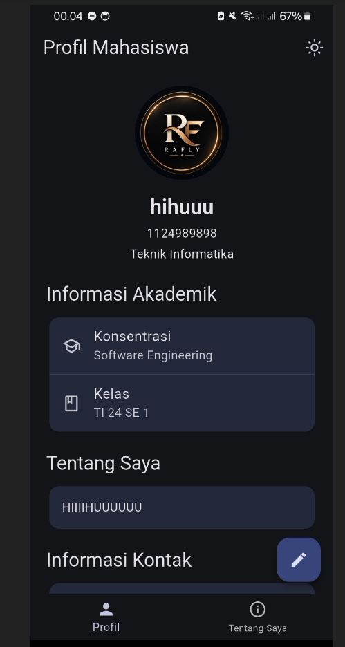
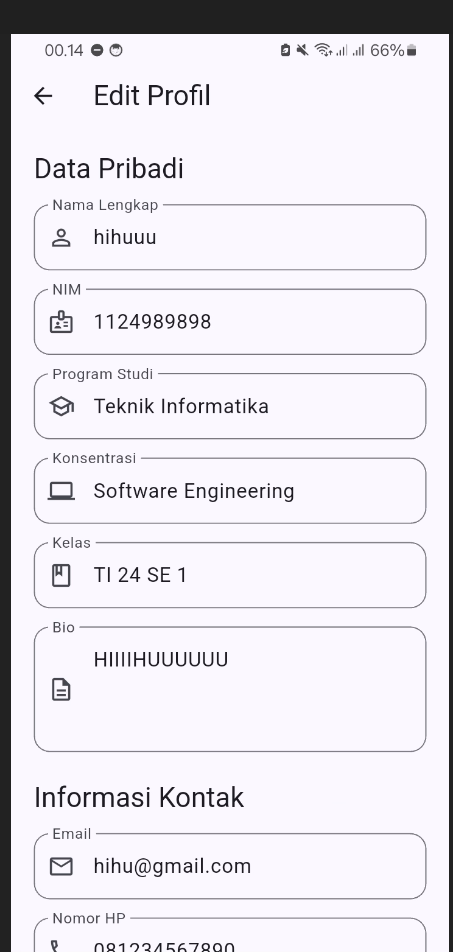
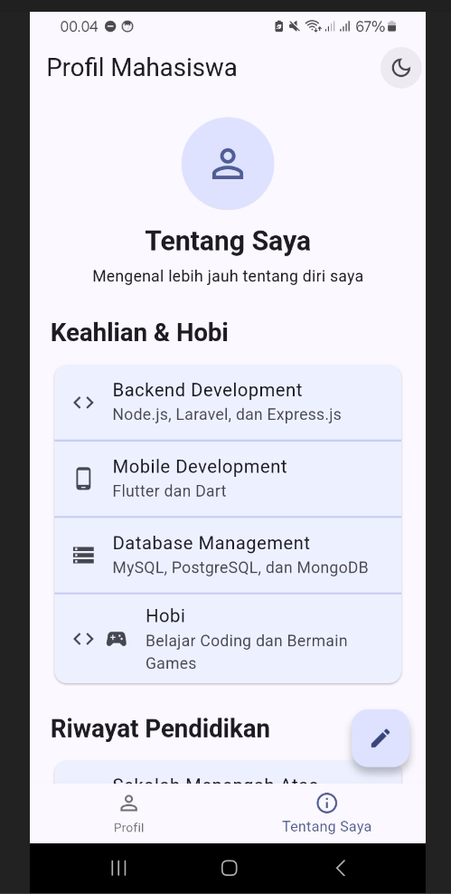

# 📱 UTS Aplikasi Mobile

Aplikasi **Profil Mahasiswa** berbasis Flutter dan Dart yang dibuat untuk memenuhi tugas Ujian Tengah Semester (UTS) mata kuliah Pemrograman Mobile.

---

## 👤 Identitas Mahasiswa

| Keterangan | Identitas |
|---|---|
| Nama | Rafly Kurniawan |
| NIM | 1124160165 |
| Program Studi | Teknik Informatika |
| Konsentrasi | Software Engineering |
| Institusi | Global Institute |

---

## ✨ Fitur Aplikasi

- **Login dengan Validasi Form** — memeriksa input email dan password sebelum pengguna masuk ke aplikasi.
- **Profil Mahasiswa** — menampilkan informasi pribadi, akademik, dan kontak.
- **Edit Profil** — memungkinkan pengguna memperbarui data profil dengan validasi input, termasuk validasi NIM.
- **Tentang Saya** — menampilkan informasi keahlian, hobi, dan riwayat pendidikan.
- **Light Mode dan Dark Mode** — menyediakan pilihan tema terang dan gelap.
- **BottomNavigationBar** — memudahkan perpindahan antara halaman Profil dan Tentang Saya.
- **FloatingActionButton** — menyediakan akses ke halaman Edit Profil.
- **Pembaruan Data Profil** — mengirimkan data hasil edit kembali ke halaman profil.

---

## 🛠️ Teknologi yang Digunakan

- Flutter
- Dart
- Material Design 3

---

## 📥 Download APK

**Versi Aplikasi:** `v1.0.0`

[⬇️ Download Aplikasi Profil Mahasiswa (app-release.apk)](https://github.com/voltakits725/uts_pml_1124160165/releases/tag/v1.0.0)

---

## 🎥 Video Presentasi

[▶️ Tonton Video Presentasi di YouTube](https://youtu.be/TpZkUUnyEqg)

> Ganti tautan di atas dengan link video YouTube setelah video presentasi diunggah.

---

## 📸 Screenshot Hasil Aplikasi

<table>
  <tr>
    <td align="center">
      <b>1. Halaman Login</b> 
      
    </td>
    <td align="center">
      <b>2. Halaman Profil</b> 
      
    </td>
  </tr>
  <tr>
    <td align="center">
      <b>3. Halaman Edit Profil</b> 
      
    </td>
    <td align="center">
      <b>4. Halaman About</b> 
      
    </td>
  </tr>
</table>

---

**Dibuat oleh Rafly Kurniawan**

UTS Pemrograman Mobile
